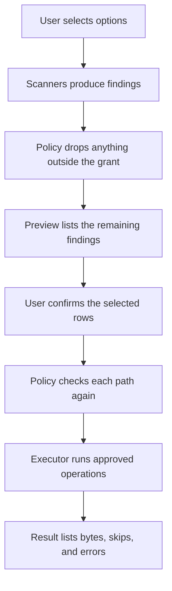

# BleachBit Mobile — project plan

Android port of BleachBit. The product description is in the [README](../README.md). This document is the plan for building it.

## Contents

- [Goals](#goals)
- [Out of scope](#out-of-scope)
- [Decisions](#decisions)
- [Privilege model](#privilege-model)
- [How a clean runs](#how-a-clean-runs)
- [Architecture](#architecture)
- [Path policy](#path-policy)
- [Cleaner catalog](#cleaner-catalog)
- [User interface](#user-interface)
- [Repository layout](#repository-layout)
- [Phases](#phases)
- [Testing](#testing)
- [Distribution](#distribution)
- [Risks](#risks)

## Goals

- Give a non-root user an honest way to remove trash, partial downloads, and files they mark, and to see which apps hold the most cache.
- Give a root user a selective cache cleaner that never treats "clear data" as a bulk action.
- Keep the BleachBit habit: preview, then clean, then a report.
- Make a buggy cleaner fail closed. The component that deletes files is separate from the component that proposes them, and a path that fails the policy aborts the remaining deletes.

## Out of scope

- iOS and other non-Android mobile systems. A BleachBit-style cleaner needs shared storage and, for the deeper cleaners, a way to read other apps' directories. Android is the system that can offer that.
- Loading desktop CleanerML files. Those cleaners target Windows and Linux desktop paths (`apt`, the Windows registry, `~/.mozilla`, and so on). Android cleaners are a new catalog. User-chosen folders cover the custom-cleaner need.
- Shredding files, wiping free space, and any promise that deleted data is forensically unrecoverable.
- Clearing app data (`pm clear`, "Clear storage") as a bulk or default action. That removes logins and local files.
- An Accessibility Service that taps Settings to press "Clear cache". It breaks across OEM skins and Android versions.
- Ads, accounts, analytics, crash uploads, and update checks. F-Droid (or the user) updates the app.
- Remote cleaner definitions. The catalog is compiled into the app. A cleaner file cannot add a new kind of delete.
- Silent cleaning. Scheduled cleaning is a late phase and only runs options the user has armed. Expert options never run unattended.
- Work-profile management beyond the profile the app is installed in. `UserHandle.myUserId()` is the only user id the cleaners use. Installed in a work profile, the app cleans that profile.

## Decisions

| Decision | Choice | Why |
| --- | --- | --- |
| Platform | Android, minSdk 29 (Android 10) | Android 10 is the first scoped-storage release. Supporting 8 and 9 means a second storage stack for a small set of devices. |
| targetSdk | Current stable API when the project is created, then kept current | The app uses the platform's delete and permission UI for that API. |
| UI and language | Kotlin, Jetpack Compose | Cache, storage, and root access are Android APIs. Compose is the UI toolkit. |
| Engine | Separate plain JVM module | Path policy and plan building have to be unit-tested on the host, with no device. |
| Root library | [libsu](https://github.com/topjohnwu/libsu), added in the root phase | Speaks to Magisk, KernelSU, and APatch through `su`. Commands are passed as argument arrays. |
| Shizuku | [Shizuku API](https://github.com/RikkaApps/Shizuku), added in the Shizuku phase | Middle privilege for people who will not root. |
| Desktop engine | Not ported | BleachBit's engine is Python plus GTK. The behavior is ported. The Python runtime is not embedded. |
| First distribution | F-Droid | GPL-3.0-or-later, no Play Services. Play Store rules for all-files access and package visibility can wait until the app's purpose is obvious from a shipping build. |
| Branding | Working title "BleachBit Mobile"; application id under a namespace this project controls | Avoid presenting the app as an official BleachBit release. |
| Default selection | Nothing is pre-checked | The user opts into every cleaner. |
| First-launch scan | None | The app explains itself and waits. |

## Privilege model

Each cleaner declares one privilege. The UI shows that privilege on the row. A cleaner whose privilege is missing is visible, marked unavailable, and cannot be selected.

| Privilege | How the user grants it | What it can reach |
| --- | --- | --- |
| Standard | Nothing beyond the per-action system dialogs | MediaStore (images, video, audio, downloads), the system trash, this app's own files, the clipboard while the app is in front |
| Usage access | System settings screen `ACTION_USAGE_ACCESS_SETTINGS` | Read-only `StorageStatsManager` figures for cache, data, and app size. No deletes of other apps. On API 30 and newer the app also declares `QUERY_ALL_PACKAGES`, so the report and the root cache cleaner can see apps the package-visibility filter would hide. |
| Folder access | Storage Access Framework tree the user picks | Files under that tree only |
| All files | `MANAGE_EXTERNAL_STORAGE`, with an explanation screen first | Shared storage through the file API, still excluding other apps' private data. `Android/data` and `Android/obb` stay closed on current Android versions. |
| Shizuku | Shizuku app plus a start from ADB or wireless debugging | Shell-level commands. Used for `pm trim-caches` and, when the shell user can see them, external cache directories. |
| Root | `su` through libsu, requested when the user opens Privileges or selects a root cleaner | Allowlisted paths under `/data/user/<id>` and external cache directories. The allowlist is the grant set in [Path policy](#path-policy). |

Startup does not probe `su`. A Magisk prompt appears only after the user asks for root.

Deletes of media this app did not create go through the platform's user-confirmed delete. On API 30 and newer that is `MediaStore.createDeleteRequest` (and `createTrashRequest` when the action moves items to trash). On API 29 the same step is the `RecoverableSecurityException` intent. Android then shows its own confirmation. The in-app confirm happens first. The app does not look for a way around the system dialog. With all-files access, shared-storage files are deleted through the file API, then MediaStore is notified.

Clipboard clearing uses `ClipboardManager.clearPrimaryClip()` and runs only from the foreground clean action. Android restricts background clipboard access, and a scheduled job will not clear it.

## How a clean runs



1. **Select.** Options remember the user's checks. Expert options are hidden until expert mode is on.
2. **Scan.** Each selected option's scanner emits findings. A finding is one row: label, size in bytes, the cleaner option, and the operation to run later. Scanners do not delete.
3. **Policy at scan time.** A finding whose path fails its grant is dropped and recorded in the run log as a policy error. It is not shown as a cleanable row.
4. **Preview.** The user unchecks rows. Unchecked rows are not part of the plan.
5. **Confirm.** The dialog states the count and the byte total. Expert mode can turn the extra confirm off. The default is on, and the control stays locked while expert mode is off.
6. **Policy at delete time.** The executor asks the policy again immediately before each delete. Paths are re-resolved with symlink-following disabled. A policy failure aborts the remaining deletes. Files already removed stay removed, and the result says the run was aborted.
7. **Execute.** One operation at a time. The result records, for each row, deleted, already gone, access denied, or failed.
8. **Report.** Bytes are the sum of the sizes of rows that were actually deleted.

Error handling during execute:

| Outcome | What the run does |
| --- | --- |
| Policy rejection | Abort the remaining deletes |
| File already gone | Count it as skipped, continue |
| Access denied, including SELinux | Record the error, continue. Do not remount, `chmod`, or change SELinux mode |
| Other I/O error | Record the error, continue |

`pm trim-caches` is the one safe operation with no file list. The preview says that Android chooses which cache files to drop and that app data is left alone. The user still confirms.

### Sizes

- A file's size is its length in bytes.
- A directory's size is the sum of the lengths of the files under it. The preview says so. Free space after the delete can differ because of allocation and because other apps recreate cache.
- The usage-access screen shows `StorageStats` from the platform and labels it as the system's figure. It is not added to walked totals.
- The root cache preview shows the walked sum, because that is the set of files the cleaner will delete.

### Long scans

MediaStore queries run in the app process with a progress indicator and a cancel button.

Duplicate hashing and full shared-storage walks run in a foreground service with a progress notification, so Android does not kill them mid-hash. Cancel stops the scan. A cancelled scan deletes nothing.

Duplicate hashing groups by size first and hashes a group only when two or more files share a size. The hash is SHA-256. The user can cancel between files.

### Relevance

A cleaner whose probe finds nothing is hidden. Examples: the package is not installed, the directory is absent, the Android version has no trash flag. A cleaner the user has checked stays visible even when the probe is empty, so the check is not lost. Large-file and duplicate tools stay visible because they are tools, not probes.

## Architecture

Two modules.

`engine` is plain Kotlin on the JVM. It does not import Android. It owns:

- `Cleaner` and `Option` identifiers, labels, privilege, and risk
- `Finding`, `Plan`, `Report`
- `Whitelist`
- `PathPolicy` and the `Grant` types
- Plan assembly: selected findings in, approved operations out

`app` is the Android application. It owns:

- Compose UI
- Scanners (MediaStore, file walk, package stats, root walk)
- The executor that performs an already-approved operation
- Permission and privilege requests
- DataStore for checks, whitelist, and settings

Scanners and the executor depend on interfaces defined so tests can substitute fakes (`Lister`, `Deleter`, `PackageCatalog`, `Clock`). The policy is not behind a fake in production tests of the executor: the executor calls the real policy.

### Operations

An operation is one of:

| Operation | Executor behavior |
| --- | --- |
| `DeleteMedia` | `ContentResolver` delete request for one URI whose authority is `media` |
| `DeleteDocument` | Delete one document that is a descendant of a granted SAF tree |
| `DeletePath` | `rm -rf -- <one path>` via libsu, or `java.nio` delete for a shared-storage file the app may remove itself. One path per call |
| `TruncatePath` | Truncate one file from the browser artifact table |
| `ClearClipboard` | `clearPrimaryClip()` |
| `TrimCaches` | `pm trim-caches <bytes>` with a single decimal argument |
| `ClearLogcat` | `logcat -c` |

The root command set starts as `rm`, `logcat`, and `pm`. A new command needs a new grant and a test that names the allowed arguments. The app never builds a shell string and never runs `sh -c`.

### Settings stored on device

- Selected option ids
- Expert mode (default off)
- Confirm before clean (default on, locked while expert mode is off)
- Whitelist of path prefixes and package names
- Large-file threshold (default 100 MB)
- Duplicate scan locations (default: Images and Downloads)
- Include system apps in the root cache cleaner (default off)
- Armed options for the later scheduler

The run log from the last scan and the last clean is kept in app storage so the user can read policy and I/O errors. It is excluded from Android backup because file names can be private. The whitelist and settings may be backed up. `allowBackup` stays at the platform default.

There is no account and no server.

## Path policy

The policy is the only code that marks an operation approved. The executor runs an operation only when this process approved it. A cleaner, a scanner, or a future import cannot bypass that call.

The threat model is a bug in a cleaner, a surprising symlink, or a path that does not match the pattern the cleaner thinks it is using. It is not a defense against another process that already has root. If a hostile process has root, the device is already that process's.

Grants:

| Grant | Allows | Rejects |
| --- | --- | --- |
| `MediaStoreUri` | A `content://media/...` URI that this scan placed in the plan | Any other authority, any file path |
| `SafTree` | A document id under the user-granted tree | Documents outside that tree |
| `SharedFile` | One regular file on `/storage/emulated/<userId>` or `/storage/<VOL>` whose relative path the scanner's predicate matched | Directories, anything under `Android/data` or `Android/obb`, anything that is not a regular file |
| `Clipboard` | The foreground clear | Any path |
| `TrimCaches` | One `pm trim-caches` with a positive byte count | Any other `pm` subcommand |
| `ExactDirectoryChildren` | Children of one fixed directory from the constant list below. The directory itself remains | The directory node, any child whose real parent is not that directory, any symlink |
| `PackageCacheDir` | One real directory matching the cache patterns below, whose package is installed | `files`, `databases`, `shared_prefs`, `no_backup`, a missing package, a symlink |
| `UninstalledPackageDir` | One directory whose name is a package id, whose parent is exactly `/data/user/<userId>` or `.../Android/data`, and whose package is not installed | Installed packages, names that fail the package pattern, deeper paths |
| `BrowserArtifact` | One file from a table of package plus relative path, resolved under `/data/user/<userId>/<package>/` | Globs, paths that leave that package directory, packages other than the row's package |

`ExactDirectoryChildren` directories:

- `/data/tombstones`
- `/data/anr`
- `/data/system/dropbox`
- `/data/local/tmp`

`PackageCacheDir` patterns, after resolving `.` and `..` and requiring every component to be a real directory (not a symlink):

- `/data/user/<userId>/<package>/cache`
- `/data/user/<userId>/<package>/code_cache`
- `/storage/emulated/<userId>/Android/data/<package>/cache`
- `/storage/emulated/<userId>/Android/data/<package>/code_cache`
- `/storage/<VOL>/Android/data/<package>/cache`
- `/storage/<VOL>/Android/data/<package>/code_cache`

`<userId>` is the decimal current user id. `<VOL>` matches `[0-9A-F]{4}-[0-9A-F]{4}`. `<package>` matches `^[a-zA-Z][a-zA-Z0-9_]*(\.[a-zA-Z][a-zA-Z0-9_]*)+$` and must be in the installed-package snapshot for `PackageCacheDir`. For `UninstalledPackageDir` it must be absent from that snapshot. The snapshot is taken at scan time and refreshed at delete time. A package that was installed between scan and delete is skipped.

Procedure for a path grant:

1. Reject empty paths, relative paths, and paths that contain a NUL.
2. Normalize `.` and `..` lexically. Reject if the path escapes its expected root during normalization.
3. `lstat` the final component. If the grant requires a directory, the final component has to be a real directory. If it is a symlink, reject. This is the check that stops a `cache` symlink from pointing at `/data`.
4. Walk the parents and require each real path to stay on the pattern. Do not follow a symlink in the chain.
5. Apply the grant's extra rule (installed package, uninstalled package, fixed directory, scanner predicate).
6. Apply the whitelist. A whitelist hit removes the finding. The whitelist cannot allow a path the grant rejected.

Immediately before `rm`, repeat steps 3–5. Then invoke `rm` as `rm -rf -- <single path>`.

### Cases the policy tests must pin

| Path or shape | Expected |
| --- | --- |
| `/data/user/0/com.foo/cache` and `com.foo` is installed | Allow under `PackageCacheDir` |
| `/data/user/0/com.foo/cache/../files` | Reject |
| `/data/user/0/com.foo/files` | Reject |
| `/data/user/0/com.foo/cache-extra` | Reject |
| `/data/user/0/cache` | Reject |
| `cache` is a symlink to another directory | Reject |
| `/data/tombstones/foo` | Allow under `ExactDirectoryChildren` |
| `/data/tombstones` itself | Reject |
| `/data/tombstones/../system/foo` | Reject |
| `/storage/emulated/0/Android/data/com.foo/files` | Reject |
| `/storage/emulated/0/Download/setup.apk` | Allow only as a `SharedFile` or media delete that the scanner emitted for that file |
| A media URI from a previous scan that is not in this plan | Reject |
| Package directory for an installed app submitted to `UninstalledPackageDir` | Reject |

These rows live as code in `engine`'s tests, not only as this table. Adding a grant means adding the rows that describe it.

## Cleaner catalog

Risk is one of:

- **Safe** — every match is cache, trash, a partial download, or a system log. The preview can select all rows.
- **Review** — the matches are user files. The UI is a picker. Nothing is deleted as a group from the main cleaner list.
- **Expert** — hidden until expert mode is on. Confirm lists the consequence (logins, local browser state, leftover app data).

Nothing in this catalog is selected by default.

| Id | Removes | Privilege | Risk | Phase |
| --- | --- | --- | --- | --- |
| `media.trash` | Items already in the system trash (`IS_TRASHED`, API 30+) | Standard | Safe | 2 |
| `downloads.partial` | Partial downloads: `.crdownload`, `.partial`, `.download`, and `.tmp` in the Download collection | Standard | Safe | 2 |
| `clipboard.current` | Current clipboard contents | Standard | Safe | 2 |
| `downloads.apk` | `.apk`, `.apks`, and `.xapk` in the Download collection. Preview starts with none of the rows checked | Standard | Review | 2 |
| `apps.cache_report` | Nothing. Lists cache and data sizes and opens the system App info screen | Usage access | Safe | 3 |
| `storage.large_files` | Nothing until the user marks files at or above the threshold | Standard | Review | 3 |
| `storage.duplicates` | Copies the user marks. The picker always leaves one copy. The default keep is the newest file in each group | Standard | Review | 3 |
| `custom.folder` | Files under a folder the user picked, matching a pattern they set (all files, or a glob) | Folder access | Review | 4 |
| `empty.dirs` | Empty directories under a picked folder | Folder access | Review | 4 |
| `thumbnails.legacy` | Files inside `DCIM/.thumbnails` when that directory exists | All files | Safe | 4 |
| `shared.logs` | `*.log` files on shared storage, outside `Android/data` and `Android/obb` | All files | Safe | 4 |
| `messengers.media` | Files older than a chosen age (default 90 days) in public messenger folders such as `WhatsApp/Media` and `Telegram`. Unchecked. Labeled as user media | All files | Review | 4 |
| `system.trim_caches` | Cache files Android chooses to drop to reach a free-space target the user sets | Shizuku | Safe | 5 |
| `apps.external_cache` | `Android/data/<pkg>/cache` and `code_cache` when the shell user can list them. Hidden when a probe says the platform blocks the listing | Shizuku | Safe | 5 |
| `apps.cache` | Private `cache` and `code_cache` of installed apps, plus external cache. User apps only, unless "include system apps" is on | Root | Safe | 6 |
| `logs.tombstones` | Contents of `/data/tombstones` | Root | Safe | 6 |
| `logs.anr` | Contents of `/data/anr` | Root | Safe | 6 |
| `logs.logcat` | The log buffer, via `logcat -c` | Root | Safe | 6 |
| `temp.local` | Contents of `/data/local/tmp` | Root | Safe | 6 |
| `logs.dropbox` | Contents of `/data/system/dropbox` | Root | Expert | 6 |
| `apps.residual` | Data directories of packages that are not installed, one directory per preview row | Root | Expert | 7 |
| `browser.cache` | Cache files of one browser, from a verified table | Root | Expert | 7 |
| `browser.cookies` | Cookie stores of one browser, from a verified table | Root | Expert | 7 |
| `browser.history` | History stores of one browser, from a verified table | Root | Expert | 7 |

Browser rows are not invented in advance. Before a browser cleaner is enabled, someone lists that app's data directory on a device, maps each file to cache, cookies, or history, and records the app version in the table. A row runs only when the expected file exists. A missing file hides the option. The first browsers are the ones the author can install and check, Firefox and Chrome. Password stores are not in the catalog. Browser sync can restore cookies and history after a clean; the option text says that.

`apps.cache` builds paths from `PackageManager`'s installed-package list. It does not walk `/data/user/<id>` and delete whatever is named `cache`. One preview row per package, expandable to the paths. Packages with an empty cache are omitted.

Messenger folders and other public media directories are a short constant list. Adding a directory is a code change with a preview, not a network update.

### Whitelist

- An entry is a path prefix or a package name.
- The preview offers "Never clean this" on a row, which adds that path or that package.
- Matching uses the real path. A finding is dropped when its path equals an entry or sits under a path entry, or when its package equals a package entry.
- Whitelist entries only remove work. They do not grant access.

### Expert mode

Off by default. Turning it on shows a one-time screen that names what expert cleaners can remove: browser logins' local state, history, cookies, leftover app directories, and system dropbox logs. Expert mode reveals expert options and unlocks the "confirm before clean" setting. Turning expert mode off hides the options and forces confirm back on.

## User interface

```
Home
  ├─ Clean                 checkbox list of Safe options available at the current privilege
  ├─ Preview               findings, sizes, per-row selection, confirm
  ├─ Result                bytes, skips, errors, link to the run log
  ├─ Large files           Review picker
  ├─ Duplicates            Review picker, grouped, one copy kept
  ├─ App sizes             usage-access report, opens system App info
  └─ Settings
       ├─ Privileges       status and request buttons for usage access, all files, Shizuku, root
       ├─ Whitelist
       ├─ Expert mode
       └─ Thresholds       large-file size, messenger age
```

Home shows the current privilege in one line (Standard, and whichever of All files, Shizuku, and Root are actually granted) and the last result if there is one. The primary action is to scan the selected cleaners.

Copy is plain. A row says what will be removed and which privilege it needs. There is no junk score, no "phone is slow" claim, and no byte count the app did not measure.

Strings live in `strings.xml` from the first screen. The first language is English.

TalkBack: icon buttons have content descriptions. This is UI accessibility. It is unrelated to the Accessibility Service, which this app does not use.

Cleaning a browser shows the package label and asks the user to close that app first. The app cannot force the other process to flush its files. The result tells the user if a file was busy.

## Repository layout

```
app/                     Compose UI, scanners, executor, permissions
engine/                  Plan, policy, whitelist, models. Plain JVM
docs/plan.md             This plan
README.md                Product description
fastlane/                Added in the F-Droid phase
```

Phase 1 chooses the application id and records it in `app/build.gradle.kts`.

Dependencies, added in the phase that needs them:

- Kotlin, Android Gradle Plugin, Compose BOM, Navigation, Lifecycle, Coroutines
- DataStore
- libsu in the root phase
- Shizuku API in the Shizuku phase

No analytics SDK and no required Play Services library, so a F-Droid build does not ship proprietary components.

GPL-3.0-or-later headers go on source files when they are created. The `LICENSE` file is added in phase 1.

## Phases

Each phase is shippable on its own. Later phases do not block an earlier one from being installed.

### Phase 1 — Skeleton and policy

Implemented. Host tests cover the pinned policy cases, including a real `cache` symlink. `./gradlew :app:assembleDebug` produces the home screen. Launching that APK on an emulator is still open.

- Gradle build, `app` and `engine`, minSdk 29, Compose, GPL header, `LICENSE`
- Engine types: findings, plan, report, whitelist, grants, path policy
- The pinned policy cases above, as host tests, including a temporary directory where `cache` is a symlink
- A Compose home screen that shows the privilege as Standard

Done when `engine`'s tests pass on the host and the app launches on an API 29 emulator and on a current-API emulator.

### Phase 2 — First clean

Implemented, not yet run on a device. `./gradlew :app:assembleDebug :app:assembleDebugAndroidTest` builds the app and three Compose UI tests (Scan is disabled until an option is selected, and tapping a preview row toggles it). No emulator or device has run them yet. Known gaps:

- A Standard app sees only the Downloads it created itself, so `downloads.partial` and `downloads.apk` find little until Phase 4's all-files access. The preview says so.
- `media.trash` needs the media read permissions to list other apps' trash. Without them the preview says only this app's trash is shown.
- Cleaner labels come from the engine in English. They are not string resources yet.
- The scanning screen has a spinner but no cancel button yet.

- `media.trash`, `downloads.partial`, `downloads.apk`, `clipboard.current`
- Preview, per-row uncheck, confirm, result
- Whitelist, including "Never clean this"
- System delete request when Android requires it
- Run log

Done when, on a non-rooted current Android device, a person can preview trash and partial downloads, uncheck one row, confirm, and see that row survive and the others go. The clipboard clears while the app is in front. A whitelisted path is absent from the preview.

### Phase 3 — Insight

- Usage-access request and the app-size list, sorted by cache, opening system App info
- Large-file picker at the configured threshold
- Duplicate picker: size groups, then SHA-256, default-keep the newest, no way to mark every copy in a group at once

Done when the size list matches the order of magnitude of the system's own storage screen for a few known apps, and a duplicate group cannot be reduced to zero copies from the picker.

### Phase 4 — Chosen folders and all-files

- SAF tree for `custom.folder` and `empty.dirs`
- All-files explanation and request
- `thumbnails.legacy`, `shared.logs`, `messengers.media` with the age control
- Foreground service for walks that can outlive a short job, with cancel

Done when a picked folder limits the custom cleaner to that tree, and messenger cleaning is off until the user checks it and then still shows a preview.

### Phase 5 — Shizuku

- Detect Shizuku, request the binder, remember a denial without asking on every launch
- `system.trim_caches` with the no-file-list explanation
- Probe external cache visibility. If the listing works, `apps.external_cache` uses the `PackageCacheDir` grant. If it fails, the cleaner is unavailable and the screen says this Android version blocks it

Done when trim-caches runs on a device with Shizuku and the external-cache probe fails closed on a version where the shell user cannot list `Android/data`.

### Phase 6 — Root cache and logs

- libsu, root request from the Privileges screen
- `apps.cache` for user apps, plus the system-app toggle
- `logs.tombstones`, `logs.anr`, `logs.logcat`, `temp.local`
- `logs.dropbox` behind expert mode
- Re-check policy immediately before each `rm`

Done when a rooted test device (or a userdebug emulator with `adb root`) loses only the cache directories of a fixture package, and a symlink planted at `cache` is left untouched and reported as a policy abort.

### Phase 7 — Residuals and browsers

- `apps.residual` with the not-installed re-check at delete time
- Browser table, verified against a recorded app version, options for cache, cookies, and history
- Expert-mode first-run explanation

Done when an installed package cannot be removed by the residual cleaner, and a browser option stays hidden when its file is absent.

### Phase 8 — F-Droid

- Fastlane metadata, screenshots of preview and result, license text
- Optional scheduler via WorkManager. It runs only options the user has armed. The armed set can contain Safe options only. Review and Expert options are rejected if something tries to arm them. The result is a notification. The first scheduled run happens after the user turns the schedule on, never from install
- English copy pass against the cleaner descriptions

Done when the F-Droid build recipe produces the artifact from source and the description matches the cleaners that are actually in that build.

## Testing

- `engine` tests run on the host with JUnit. They are the release gate for path policy. A policy test failure fails the build.
- Scanners are tested against fake listers that return fixture trees, including the symlink cases.
- The executor test uses a fake process runner that records argv. A test asserts the runner never receives a single shell string, and that a policy rejection produces no `rm`.
- UI tests cover: empty selection, preview uncheck, whitelist drop, expert options hidden by default.
- Manual pass before a release, on a non-root device and on a rooted device when the root phase exists:
  - API at minSdk (29 or 30)
  - The two newest public Android releases at that time
  - One OEM skin if a device is available
  - Shizuku on and off, once phase 5 exists
  - A planted symlink at a cache path, once phase 6 exists

Instrumented MediaStore tests are useful and are not a substitute for the manual pass. OEM storage providers disagree.

## Distribution

F-Droid is the first channel. The listing states, in the first paragraph, what works without root and what needs Shizuku or root.

Play Store is a later decision. If it happens, the listing has to justify all-files access and package visibility as core behavior, and the build still has no analytics SDK. The app will not take an Accessibility Service to get through Play review.

The F-Droid description and the in-app privilege screen have to agree. A cleaner that is not in the build is not in the description.

## Risks

| Risk | What we do |
| --- | --- |
| A cache path is a symlink to something important | Final component must be a real directory. Policy tests plant a symlink. Failure aborts the rest of the run |
| `rm` is called with a joined shell string | Argv only, asserted in executor tests. One path per call |
| Users expect "clean" to wipe app data | Cache and data are separate on every screen that mentions them. `pm clear` is not an operation |
| Cache returns quickly and the app looks like it lied | The result reports bytes removed, not "space you will keep" |
| `Android/data` access changes between Android releases | External cache is probe-based. A failed probe hides the cleaner |
| Messenger cleaning deletes files people wanted | Review flow, off by default, age filter, preview |
| Browser cleaner paths go stale after an app update | The option hides itself when the file is missing. The table names the version it was checked against |
| Trademark confusion with upstream BleachBit | Independent-port notice in the README and the F-Droid listing. Application id outside `org.bleachbit` until upstream agrees |
| Scope growth into a general file manager | Large files and duplicates stay pickers. The main list stays limited to declared cleaners |
